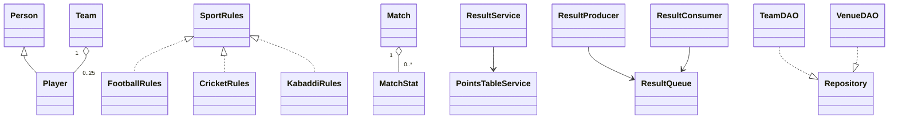
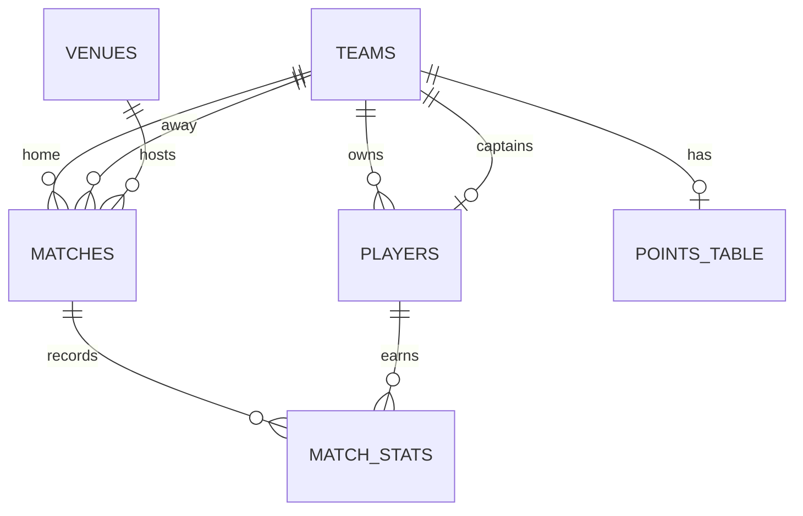
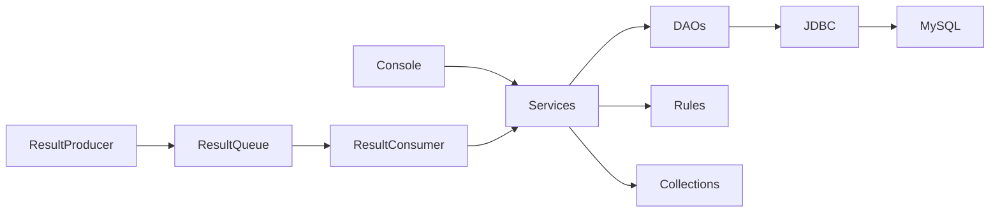

# Sportify Tournament Manager

Sportify is a learner-oriented Java console project for managing one football, cricket, or kabaddi tournament. It demonstrates object-oriented models, collections, synchronized threads, a producer-consumer result queue, JDBC/MySQL persistence, streams, and CSV file handling.

## Requirements and setup

- JDK 17 or newer (the project was compiled here with JDK 27).
- MySQL 8.0 or newer.
- MySQL Connector/J on the compile and runtime classpaths.

1. Run `sql/sportify_schema.sql` in MySQL. The script recreates the Sportify tables and inserts the demo data.
2. Set `DB_URL`, `DB_USERNAME`, and `DB_PASSWORD` in `src/database/DBConnection.java` to your MySQL connection details. Select the tournament sport with `-Dsportify.sport=FOOTBALL`, `CRICKET`, or `KABADDI`.
3. Compile and run from the project root (replace the connector path with your installed JAR):

```powershell
javac -cp "lib/mysql-connector-j.jar" -d out (Get-ChildItem src -Recurse -Filter *.java | ForEach-Object FullName)
java -cp "out;lib/mysql-connector-j.jar" main.SportifyApp
```

The schema seeds username `admin` with password `sportify123`; the stored value is a salted PBKDF2 hash. Change it for any real use. The SQL script seeds football teams T01–T04, venue V01, 44 players, and matches M101–M103. M102 is a 0–0 draw; M101 and M103 are scheduled. M103 is on a separate date so T01 does not play twice on one day.

## Assumptions

- Squad size is at most 25; players are 14–50 years old; jersey numbers are 1–99.
- Player IDs, team IDs, venue IDs, and match IDs are provided by the administrator and are unique.
- One match uses a date plus exact start time as its venue slot. The app checks teams against all scheduled matches on the same date.
- The captain must be a player on that team. The schema's captain foreign key is added after the players table to resolve the teams/players circular reference; create teams, create players, then set captains.
- Score difference is the simple total score difference. It is a teaching substitute for cricket net run rate.
- MVP is the player with the largest sum of `score_contribution` in completed match stats. Cricket and kabaddi use the same stored contribution field; the display label comes from the selected sport rules.
- `secondary_contribution` is available for a second stat such as assists, wickets, or tackles. Leaderboard ordering currently uses the primary contribution.
- CSV import columns are `player_id,name,age,role,jersey_no,team_id`. Blank lines are counted as skipped. Quotes and doubled quotes are supported.
- The points-table seed reflects M102's 0–0 draw; after M101 is entered as 2–1, expected values are T01 3 (+1), T02 0 (-1), T03 1 (0), T04 1 (0).

## Demo and concepts

The SQL setup provides the end-to-end tournament records. Runnable focused demos are:

```powershell
java -cp out main.CollectionsDemo
java -cp out main.ConcurrencyDemo
java -cp out main.QueueAndExecutorDemo
java -cp out main.ModelDemo
java -cp out main.AnalyticsDemo
java -cp out main.CsvValidationDemo
```

`SportifyApp` runs the database-backed menu and requires the local MySQL config and Connector/J. `ModelDemo` demonstrates validated model construction and sport-rule polymorphism without a database.

For the seeded story, log in as `admin` / `sportify123`, choose option 5 for M101 with score 2–1 and provide the scorers' player IDs and contributions, then choose option 13 to process the queued result. Option 6 should then show T01 3 (+1), T02 0 (-1), T03 1 (0), and T04 1 (0). Option 7 displays scorers and MVP; option 11 can import `data/players.csv` (three valid rows and one invalid-age row), and option 12 writes reports under `reports/`. Run `main.ConcurrencyDemo` to see the five-thread slot contest.

Without synchronization, two booking threads could both see a slot as free before either marks it taken. `VenueSlotManager` protects the check and booking as one critical section on the shared manager. Calling `run()` directly executes on the caller's thread; `start()` creates a new thread. The demo uses `join()` before checking totals and interrupts a sleeping thread to demonstrate interrupt handling.

### Class diagrams



### ER diagram



### Architecture



## Concepts map

| Concept | Location |
|---|---|
| Inheritance and overriding | `model/Person.java`, `model/Player.java`, `Player.getDisplayInfo()` |
| Interface and polymorphism | `rules/SportRules.java`, `rules/*Rules.java` |
| Validation and custom exceptions | `model/*`, `exception/*` |
| ArrayList, HashMap, HashSet, Iterator | `service/TeamService.java`, `service/PlayerService.java` |
| Comparator and streams | `service/PlayerService.java`, `service/PointsTableService.java`, `service/AnalyticsService.java` |
| Synchronized critical section | `concurrency/VenueSlotManager.java`, `model/PointsEntry.java` |
| wait/notifyAll producer-consumer | `concurrency/ResultQueue.java` |
| Executor, Callable, Future | `main/QueueAndExecutorDemo.java` |
| JDBC and prepared statements | `database/DBConnection.java`, `dao/*DAO.java` |
| JDBC transaction and rollback | `service/ResultService.recordResultInDatabase()` |
| Generic repository | `repository/Repository.java`, `dao/TeamDAO.java`, `dao/VenueDAO.java` |
| BufferedReader/BufferedWriter CSV | `util/CsvImporter.java`, `util/CsvExporter.java` |

## Viva questions

- **M1:** Why does `Player` extend `Person`? A player is a person, so it reuses validated name/age data and overrides display output with player details.
- **M2:** Why use both a list and a map? The list preserves display order; the map gives direct ID lookup.
- **M3:** What does synchronization protect? The single check-and-add booking operation on the shared venue manager, so two threads cannot both claim one slot.
- **M4:** Why is `wait()` inside a `while` loop? A thread must recheck the queue condition after waking because another thread may have changed it first.
- **M5:** Why use a transaction for results? Match score, player stats, and both teams' points must either all persist or all roll back.
- **M6:** Which stream operations are terminal? `collect`, `average`, and `count`; filter/map/sorted are intermediate.
- **M7:** Why use a generic repository? The same save/find/list/delete contract works for both team and venue DAOs while keeping entity types checked.
- **M8:** Why hash admin passwords? A DB leak should not expose passwords directly; the stored value includes a random salt and a slow PBKDF2 derivation.
